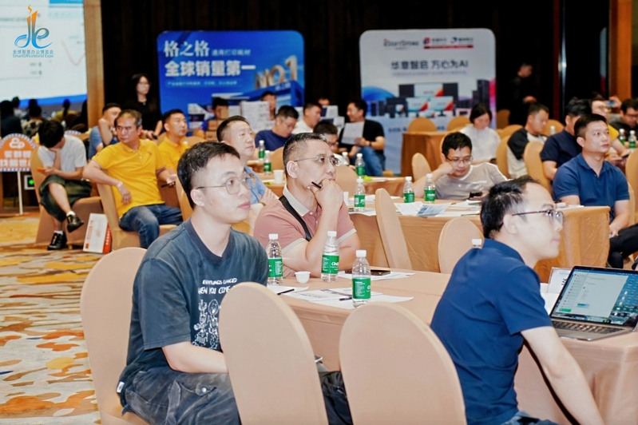
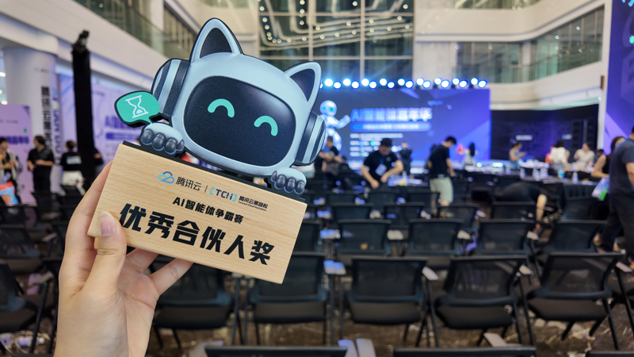
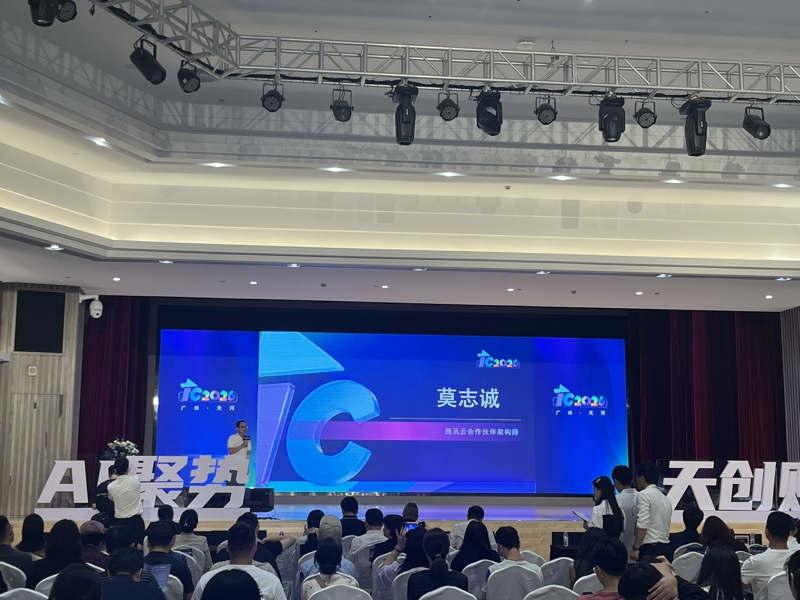
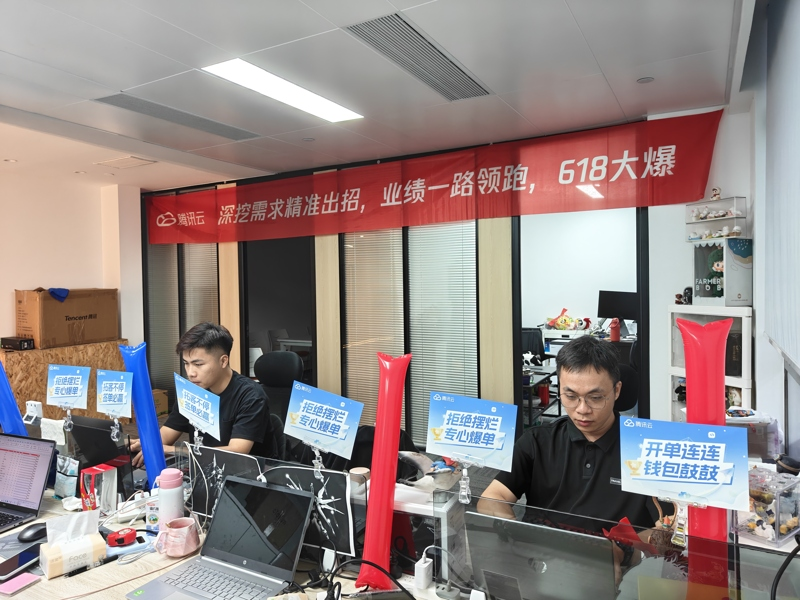

<!-- WebGL 流体背景 -->

<!-- Hero -->
<header class="hero" id="top">

NEWS CENTER · 新闻中心

<h1 class="reveal reveal-d1">动态与思考， 都在 AI 落地的路上</h1>

这里有麦朴的最新动态、产品发布与行业洞察，也有客户最关心的常见问题。我们相信透明与专业，是企业级服务的起点。

30+ 篇/年

动态与洞察持续更新

12 条

高频问答即时解答

15+ 场/年

线上线下活动分享

<a href="#news" class="btn btn-primary">浏览最新动态 <svg viewBox="0 0 24 24" fill="none" stroke="currentColor" stroke-width="2.5"><path d="M12 5v14M5 12l7 7 7-7"/></svg></a>
<a href="#faq" class="btn btn-ghost">查看常见问答</a>

</header>

<!-- 置顶要闻 -->
<section class="featured" id="headline">

HEADLINE · 本月要闻

<h2 class="sec-title">麦朴蝉联腾讯云华南殿堂级服务商</h2>

凭借企业级交付能力与客户口碑，麦朴再次通过腾讯云最高等级服务商认证，继续稳居华南最大代理商之列。

要闻头条

以最高等级资质， 服务华南企业智能化升级

2017-08-22

公司动态 · 资质认证

<h3>麦朴为克拉波互娱提供大模型Token聚合服务，AI调用成本降低42%</h3>

近日，广州麦朴科技有限公司宣布，其为国内新锐游戏研发厂商——克拉波互娱游戏提供的大模型Token供应与AI工具服务取得突破性成果 ...

殿堂级 · 最高等级
华南最大代理商
云 + AI 双引擎

<a href="/news-kelabo-token.html" class="featured-read">阅读全文 <svg viewBox="0 0 24 24" fill="none" stroke="currentColor" stroke-width="2.5"><path d="M5 12h14M13 6l6 6-6 6"/></svg></a>

</section>

<!-- 新闻列表 -->
<section class="news-section" id="news">

LATEST · 企业动态

<h2 class="sec-title">最新动态与洞察</h2>

<button class="active" data-filter="all">全部</button>
<button data-filter="company">公司动态</button>
<button data-filter="insight">行业新闻</button>

<a href="/news-kelabo-token.html" class="news-item n-company reveal" data-cat="company">

08-222017

公司动态
<h3>麦朴为克拉波互娱提供大模型Token聚合服务，AI调用成本降低42%</h3>

近日，广州麦朴科技有限公司宣布，其为国内新锐游戏研发厂商——克拉波互娱游戏提供的大模型Token供应与AI工具服务取得突破性成果。经过10个月的持续合作，麦朴的Token聚合供应方案帮助克拉波 ...

<svg viewBox="0 0 24 24" fill="none" stroke="currentColor" stroke-width="2.5"><path d="M5 12h14M13 6l6 6-6 6"/></svg>

</a><a href="/news-jinyi-agent.html" class="news-item n-company reveal" data-cat="company">

08-162017

公司动态
<h3>麦朴为广东金亿防护定制企业级AI Agent，售前接待响应时效缩短70%</h3>

近日，广州麦朴科技有限公司宣布，其为华南安全防护用品领军企业——广东金亿防护定制的企业级AI智能体（Agent）项目成功落地并取得显著成效。经过8个月的深度合作，麦朴为金亿防护搭建的售前智能接 ...

<svg viewBox="0 0 24 24" fill="none" stroke="currentColor" stroke-width="2.5"><path d="M5 12h14M13 6l6 6-6 6"/></svg>

</a><a href="/news-banana-climbing.html" class="news-item n-company reveal" data-cat="company">

08-162017

公司动态
<h3>麦朴携手香蕉攀岩，AI运营工具与培训陪跑助力连锁品牌效率提升210%</h3>

近日，广州麦朴科技有限公司宣布，其为国内攀岩连锁场馆TOP品牌——香蕉攀岩提供的AI运营工具与培训陪跑服务取得显著成效。经过6个月的深度合作，香蕉攀岩全员AI工具应用覆盖率达90%，门店内容产出效 ...

<svg viewBox="0 0 24 24" fill="none" stroke="currentColor" stroke-width="2.5"><path d="M5 12h14M13 6l6 6-6 6"/></svg>

</a><a href="/news-gac-cloud-cooperation.html" class="news-item n-company reveal" data-cat="company">

08-162017

公司动态
<h3>麦朴与广汽集团达成年度云计算与AI落地战略合作，助力世界500强企业数字化转型</h3>

近日，广州麦朴科技有限公司与广汽集团正式签署年度云计算与AI落地战略合作协议。作为《财富》世界500强企业、中国汽车行业头部企业，广汽集团选择麦朴作为其云计算与AI落地的战略合作伙伴，标志着微 ...

<svg viewBox="0 0 24 24" fill="none" stroke="currentColor" stroke-width="2.5"><path d="M5 12h14M13 6l6 6-6 6"/></svg>

</a>   

 

</section>

<!-- 常见问答 -->
<section class="faq-section" id="faq">

<aside class="faq-aside reveal">

FAQ · 常见问答

<h2 class="sec-title">您可能想先了解</h2>

采购前的高频问题，都在这里。没有找到答案？直接联系我们。

<h4>还有其他问题？</h4>

商务团队工作日 9:00–18:00 在线，通常 2 小时内响应。也可以先预约一次免费场景诊断。

<a href="tel:18926108189" class="btn btn-primary">电话咨询 <svg viewBox="0 0 24 24" fill="none" stroke="currentColor" stroke-width="2"><path d="M22 16.92v3a2 2 0 0 1-2.18 2 19.79 19.79 0 0 1-8.63-3.07 19.5 19.5 0 0 1-6-6 19.79 19.79 0 0 1-3.07-8.67A2 2 0 0 1 4.11 2h3a2 2 0 0 1 2 1.72c.127.96.36 1.903.7 2.81a2 2 0 0 1-.45 2.11L8.09 9.91a16 16 0 0 0 6 6l1.27-1.27a2 2 0 0 1 2.11-.45c.907.34 1.85.573 2.81.7A2 2 0 0 1 22 16.92z"/></svg></a>

</aside>

<button class="faq-q" aria-expanded="true">
01
麦朴具体提供哪些服务？分别解决什么问题？

</button>

麦朴围绕企业 AI 能力建设提供<strong>七大产品、可独立采购也可组合交付</strong>：
<ul>
<li><strong>AI 提效</strong> —— 学·用·建·管一站式闭环，解决「不会用、用不好」的问题</li>
<li><strong>云计算服务</strong> —— 腾讯云华南殿堂级服务商，架构咨询、迁移部署、运维托管、成本优化</li>
<li><strong>AI 落地</strong> —— 五步法交付，让具体业务场景真正用上 AI</li>
<li><strong>AI 转型</strong> —— 战略与场景咨询、知识库建设咨询、内化体系咨询</li>
<li><strong>Agent 定制</strong> —— FDE 现场共创，知识问答、客服、销售辅助等七类 Agent</li>
<li><strong>Token 供应</strong> —— GPT、Gemini 等主流模型用量，成本约官网 45 折</li>
<li><strong>WorkBuddy 培训</strong> —— 线上 + 线下七大模块，50 席起购</li>
</ul>

<button class="faq-q" aria-expanded="false">
02
我们是传统行业，员工 AI 基础薄弱，从哪里开始？

</button>

大多数客户的起点是<strong>WorkBuddy 培训 + 场景诊断</strong>：先用标准化课程建立全员 AI 通识与工具使用能力（方案 B 标准化课程包，50 席起），同时由顾问完成业务场景盘点，识别 3–5 个高价值场景；再通过<strong>方案 A 诊断式定制训练营</strong>针对重点部门做场景化训练。跑通「培训 → 场景 → 落地」的第一段闭环后，再决定是否进入 Agent 定制或深度咨询。

<button class="faq-q" aria-expanded="false">
03
Token 成本「约官网 45 折」是怎么回事？有没有隐性限制？

</button>

麦朴以<strong>企业级代理规模</strong>向模型方统一采购用量，再按企业实际消耗结算，因此单价显著低于个人官网充值（约 45 折）。采购 WorkBuddy 50 席以上的客户另获 <strong>2000 元模型兑换券</strong>。没有隐藏条款：支持的模型（GPT、Gemini 等）、计量方式、结算周期均在合同中明确，并配套<strong>用量看板与预算告警</strong>，成本透明可控。

<button class="faq-q" aria-expanded="false">
04
Agent 定制的交付流程是怎样的？需要我们投入多少人力？

</button>

我们采用 <strong>FDE（现场解决方案工程）五步法</strong>：
<ul>
<li><strong>场景定义</strong> —— 与业务方共同圈定高价值场景</li>
<li><strong>知识流程</strong> —— 梳理知识来源与业务流程</li>
<li><strong>原型</strong> —— 快速构建可试用 Agent 原型</li>
<li><strong>测试试点</strong> —— 小范围真实业务验证</li>
<li><strong>推广交接</strong> —— 全面推广并完成能力交接</li>
</ul>
客户侧通常只需<strong>1 名业务对接人 + 若干场景专家按需参与</strong>（累计约 5–8 个工作日），重活由我们的 FDE 工程师承担。

<button class="faq-q" aria-expanded="false">
05
企业数据安全吗？知识库和模型调用会不会造成数据外泄？

</button>

数据安全是企业级服务的底线。方案基于<strong>腾讯云企业级基础设施</strong>部署（麦朴为腾讯云华南殿堂级服务商），支持私有化/专有云形态；知识库数据<strong>存储在客户自有空间</strong>，模型调用支持企业独立密钥与审计日志；敏感行业可配置数据脱敏与访问权限分级。所有数据处理条款写入合同，绝不将客户数据用于任何二次用途。

<button class="faq-q" aria-expanded="false">
06
培训是线上还是线下？课程可以按我们行业定制吗？

</button>

两种形态都支持。<strong>线上</strong>：WorkBuddy 平台使用与 Prompt 工程课程；<strong>线下</strong>：七大模块（AI 通识 / AI 思维 / AI Cost Optimization / Vibe Coding / 业务场景训练营 / 个人知识库等）。两种采购模式：
<ul>
<li><strong>方案 A · 诊断式定制训练营</strong> —— 先诊断业务痛点，课程案例全部替换为贵司真实场景</li>
<li><strong>方案 B · 标准化课程包</strong> —— 成熟课程直接开班，快速覆盖全员</li>
</ul>

<button class="faq-q" aria-expanded="false">
07
云计算服务只面向已经在用腾讯云的企业吗？

</button>

不是。我们服务三类客户：<strong>计划上云</strong>的企业（架构选型与规划）、<strong>已在用腾讯云</strong>的企业（架构优化、运维托管、成本优化，通常能找到 10%–30% 的降本空间）、以及<strong>多云环境</strong>中希望统一治理的企业。作为华南最大代理商，我们还能提供官方渠道的商务政策支持。

<button class="faq-q" aria-expanded="false">
08
一项 AI 落地项目通常周期多长？怎么衡量效果？

</button>

单场景 Agent 原型通常 <strong>2–4 周</strong>可试用，试点验证 4–8 周，随后进入推广交接。效果衡量在项目启动前就与客户共同定义，常见指标包括：任务耗时下降、人工工时节省、Token 成本优化幅度、培训后 AI 使用率等。我们坚持<strong>「先定义指标，再开始项目」</strong>，避免交付无法量化的「演示级 AI」。

<button class="faq-q" aria-expanded="false">
09
采购门槛高吗？中小企业是否适合？

</button>

七大产品均可<strong>独立采购、小步启动</strong>：WorkBuddy 培训 50 席起购；Token 供应按实际用量结算；Agent 定制可从单个最小场景开始。不少客户从「一次培训 + 一个 Agent」起步，验证价值后再扩展。我们的客户从数千人的制造集团到几十人的专业服务机构都有覆盖。

<button class="faq-q" aria-expanded="false">
10
如何开始合作？第一步需要做什么准备？

</button>

最简单的方式是<strong>预约一次免费场景诊断</strong>（约 1 小时，线上或线下）：带上您当前最耗人力的 2–3 个业务环节即可，我们会输出一份初步的 AI 落地优先级建议。确定合作意向后签订框架协议，按里程碑分阶段推进。联系电话见页面底部，或发邮件至 sales@xomaps.com。

</section>

<!-- CTA -->
<section class="cta-section" id="contact">

<h2>想了解更适合您的 AI 落地路径？</h2>

预约一次免费场景诊断，或直接与商务团队沟通。工作日 9:00–18:00，通常 2 小时内响应。

<a href="tel:18926108189" class="btn btn-accent">立即拨打商务电话 <svg viewBox="0 0 24 24" fill="none" stroke="currentColor" stroke-width="2.5"><path d="M22 16.92v3a2 2 0 0 1-2.18 2 19.79 19.79 0 0 1-8.63-3.07 19.5 19.5 0 0 1-6-6 19.79 19.79 0 0 1-3.07-8.67A2 2 0 0 1 4.11 2h3a2 2 0 0 1 2 1.72c.127.96.36 1.903.7 2.81a2 2 0 0 1-.45 2.11L8.09 9.91a16 16 0 0 0 6 6l1.27-1.27a2 2 0 0 1 2.11-.45c.907.34 1.85.573 2.81.7A2 2 0 0 1 22 16.92z"/></svg></a>

<svg viewBox="0 0 24 24" fill="none" stroke="currentColor" stroke-width="2"><path d="M22 16.92v3a2 2 0 0 1-2.18 2 19.79 19.79 0 0 1-8.63-3.07 19.5 19.5 0 0 1-6-6 19.79 19.79 0 0 1-3.07-8.67A2 2 0 0 1 4.11 2h3a2 2 0 0 1 2 1.72c.127.96.36 1.903.7 2.81a2 2 0 0 1-.45 2.11L8.09 9.91a16 16 0 0 0 6 6l1.27-1.27a2 2 0 0 1 2.11-.45c.907.34 1.85.573 2.81.7A2 2 0 0 1 22 16.92z"/></svg>

商务咨询
冯小姐 · 18926108189

<svg viewBox="0 0 24 24" fill="none" stroke="currentColor" stroke-width="2"><path d="M21 10c0 7-9 13-9 13s-9-6-9-13a9 9 0 0 1 18 0z"/><circle cx="12" cy="10" r="3"/></svg>

总部地址
广州市天河区科韵路16号信息港A栋1510

<svg viewBox="0 0 24 24" fill="none" stroke="currentColor" stroke-width="2"><path d="M3 7l9 6 9-6M3 7v10a2 2 0 0 0 2 2h14a2 2 0 0 0 2-2V7M3 7l2-2h14l2 2"/></svg>

企业邮箱
sales@xomaps.com

</section>

<!-- ══════════ WebGL 流体特效（Three.js） ══════════ -->

